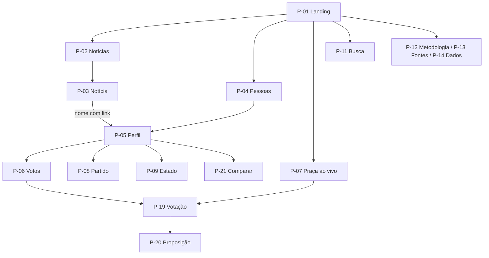

# PÁGINAS: inventário, conteúdo e layout

> Complementa o `PLANO.md` (§5 e Fase 2). Cada página é uma **prancha** numerada (P-01, P-02…), como as pranchas de um projeto de arquitetura.
> Linguagem visual: direção *Tinta & Papel* (`design/tokens.css`). Os esquemas abaixo são **plantas baixas**: mostram a ordem e o peso dos blocos, não o visual final.
> Grade: 12 colunas no desktop, 4 no mobile. "8|4" = conteúdo em 8 colunas + lateral em 4.

**Legenda de prioridade:** 🟢 **v1** (lançamento) · 🟡 **v1.x** (logo depois) · ⚪ **futuro**

---

## 0. Peças comuns a todas as páginas

| Peça | Descrição |
|---|---|
| **Barra tripartite** | Faixa de 5px (verdigris, âmbar, índigo) no topo. |
| **Cabeçalho fixo** | Logo, menu (Pessoas, Como funciona, Guia do cidadão, Glossário, Notícias, Praça ao vivo, Metodologia, Fontes), busca com atalho `/` e botão de tema. No mobile mantém acesso direto sem cortar links. |
| **Faixa "ao vivo"** | Só aparece quando há sessão transmitida: "● AO VIVO · Plenário da Câmara" com link para P-07. |
| **Trilha (breadcrumb)** | `Início › Pessoas › Fulana de Tal`. |
| **Régua de fonte** | Linha mono abaixo de cada dado: `FONTE · órgão · coletado em … ↗`. |
| **Rodapé** | Links institucionais, licenças (AGPL / ODbL), última atualização dos dados, "Corrigir um dado", aviso de independência. |
| **Estados vazios** | Nunca campo em branco. Sempre "Sem dado disponível na fonte (consultada em …)". |

---

## 1. Inventário

### 🟢 v1: lançamento

| # | Página | Rota |
|---|---|---|
| P-01 | Landing (início) | `/` |
| P-02 | Notícias (agregador) | `/noticias` |
| P-03 | Notícia (leitura interna) | `/noticias/[ano]/[slug]` |
| P-04 | Lista de pessoas | `/pessoas` |
| P-05 | Perfil da pessoa | `/pessoas/[slug]` |
| P-06 | Votações da pessoa (subpágina) | `/pessoas/[slug]/votos` |
| P-07 | Praça dos Três Poderes ao vivo | `/ao-vivo` |
| P-08 | Partido | `/partidos/[sigla]` e índice `/partidos` |
| P-09 | Estado | `/estados/[uf]` e índice `/estados` |
| P-10 | Poder | `/poderes/[legislativo\|executivo\|judiciario]` |
| P-11 | Busca | `/busca?q=` |
| P-12 | Metodologia | `/metodologia` (+ âncoras por índice) |
| P-13 | Fontes de dados | `/fontes` |
| P-14 | Dados abertos (downloads) | `/dados` |
| P-15 | Corrigir um dado + log de correções | `/corrigir`, `/correcoes` |
| P-16 | Sobre / política editorial | `/sobre`, `/editorial` |
| P-17 | Privacidade e termos | `/privacidade`, `/termos` |
| P-18 | 404 e erro | — |
| P-26 | Glossário cívico, orçamentário e jurídico | `/glossario` |
| P-37 | Como funciona o Brasil (Pacto Federativo, Poderes, Leis, Orçamento e Eleições) | `/aprender` |
| P-40 | Guia do cidadão (como participar, cobrar e fiscalizar) | `/guia-do-cidadao` |

### 🟡 v1.x: logo após o lançamento

| # | Página | Rota |
|---|---|---|
| P-19 | Votação (uma votação nominal) | `/votacoes/[id]` |
| P-20 | Proposição (projeto de lei) | `/proposicoes/[tipo-numero-ano]` |
| P-21 | Comparar pessoas (2 a 4) | `/comparar?p=a,b` |
| P-22 | Agenda (pauta da semana) | `/agenda` |
| P-23 | Eleições 2026 (resultados, eleitos) | `/eleicoes/2026` |
| P-24 | Órgão / comissão | `/orgaos/[id]` |
| P-25 | Tema (ex.: saúde, impostos) | `/temas/[slug]` |
| P-27 | Linha do tempo do mandato do governo | `/governo` |

### ⚪ Futuro

| # | Página | Ideia |
|---|---|---|
| P-28 | Empresa / doador | Quem doou para quem, sanções, contratos públicos |
| P-29 | Emendas no mapa | Para onde foi o dinheiro das emendas, por município |
| P-30 | Gastos (ranking da cota) | Rankings com contexto, sem sensacionalismo |
| P-31 | Caso (processo/suspeita) | Uma página por caso documentado (depende da Fase 7) |
| P-32 | Assembleias e câmaras municipais | Expansão do escopo |
| P-33 | Órgãos de controle (PGR, TCU, CGU) | Expansão do escopo |
| P-34 | "Meu alerta" | Seguir pessoas/temas por RSS ou e-mail (sem conta obrigatória) |
| P-35 | API pública e documentação | `/api` para desenvolvedores |
| P-36 | Quiz "Quem vota como você" | Compara suas respostas com votações reais (metodologia aberta) |
| P-38 | Versão em inglês / acessível (Libras, leitura fácil) | Alcance |
| P-39 | Status do sistema | Saúde de cada coletor e fonte |

---

## 2. Pranchas: conteúdo e layout (v1)

### P-01 · Landing `/`
**Objetivo:** em 5 segundos, entender o que o site faz e achar uma pessoa.

```
┌──────────────────────────────────────────────────────────┐
│ [faixa AO VIVO, se houver]                               │
├───────────────────────────────┬──────────────────────────┤
│ H1 grande (serifa)            │  SVG da Praça            │
│ "Quem decide, como vota       │  3 marcadores pulsando   │
│  e quem paga."                │  → leva a P-07           │
│ [ busca grande ............ ] │                          │
├──────────┬──────────┬─────────┴┬─────────────────────────┤
│ LEGISL.  │ EXECUT.  │ JUDIC.   │ ← cartões dos Poderes    │
│ 594      │ 29+      │ 11       │   (contadores)           │
├──────────┴──────────┴──────────┴─────────────────────────┤
│ 8 | ÚLTIMAS NOTÍCIAS (6)       │ 4 | HOJE NA PRAÇA        │
│   título · veículo · data      │   agenda do dia          │
│   pessoas citadas (chips)      │   votações previstas     │
├────────────────────────────────┴─────────────────────────┤
│ VOTAÇÕES DA SEMANA: 3 cartões com placar (Sim × Não)     │
├──────────────────────────────────────────────────────────┤
│ EXPLORE: por estado (mapa do Brasil) | por partido       │
├──────────────────────────────────────────────────────────┤
│ COMO FUNCIONA: 3 passos + "todo dado tem fonte"          │
└──────────────────────────────────────────────────────────┘
```
Mobile: busca logo abaixo do H1; Praça vira faixa horizontal compacta; cartões em carrossel.

---

### P-02 · Notícias `/noticias`
**Objetivo:** acompanhar o noticiário político num só lugar, filtrado por Poder, pessoa e tema.

```
┌──────────────────────────────────────────────────────────┐
│ H1 Notícias        [filtros: Poder ▾ Tema ▾ Veículo ▾]   │
│ abas: Todas | Oficiais | Imprensa                        │
├───────────────────────────────────────┬──────────────────┤
│ 8 | DESTAQUE (1 grande)               │ 4 | MAIS CITADOS │
│ ───────────────────────────────────── │   hoje: 5 rostos │
│ lista cronológica agrupada por dia    │ ──────────────── │
│ ▸ título (serifa)                     │   TEMAS EM ALTA  │
│   VEÍCULO · 14:32 · selo [Oficial]    │ ──────────────── │
│   chips das pessoas citadas           │   RSS / alertas  │
│ [carregar mais]                       │                  │
└───────────────────────────────────────┴──────────────────┘
```
Selos: **Oficial** (agências públicas), **Imprensa**, **Leitura no site** (quando P-03 existe) ou **↗ Externo**.

---

### P-03 · Notícia `/noticias/[ano]/[slug]`

> [!IMPORTANT]
> **Direitos autorais.** Notícia é obra protegida (Lei 9.610/98). Uma API que *entrega* o texto não dá o *direito de republicar*. A leitura completa no site só vale para:
> 1. **Fontes com licença aberta:** Agência Brasil/EBC (CC BY 4.0, a confirmar) e, a verificar, Agência Câmara, Agência Senado e notícias do STF.
> 2. **Veículos com acordo escrito** de reprodução.
> 3. **Texto escrito pelo próprio site.**
>
> Para o resto da imprensa: título + trecho curto (até ~2 frases) + link para o original. Isso já está nos princípios (`recursos-apis.md` §2.4).

**Edições permitidas (fontes abertas):** colocar link nos nomes de pessoas que levam ao perfil, adicionar caixas de contexto e corrigir formatação. **Nunca alterar o sentido do texto.** Cada edição fica registrada no rodapé ("links e contexto adicionados por Praça").

```
┌──────────────────────────────────────────────────────────┐
│ trilha › Notícias › Legislativo                          │
├───────────────────────────────────────┬──────────────────┤
│ 8 | selo [Agência Câmara · CC BY]     │ 4 | (fixo ao     │
│ H1 título (serifa grande)             │      rolar)      │
│ linha fina                            │ PESSOAS NESTA    │
│ autor · veículo · publicado · lido em │ NOTÍCIA          │
│ ───────────────────────────────────── │ ┌──────────────┐ │
│ corpo (66ch)                          │ │FT Fulana XYZ │ │
│ ...a deputada [Fulana de Tal]⁽ᵖ⁾ ...  │ │ dep. · UF    │ │
│   ↳ ao passar o mouse: mini-cartão    │ │ 94% presença │ │
│     (foto, cargo, partido, link)      │ └──────────────┘ │
│ ┌ CONTEXTO (fundo papel-fundo) ─────┐ │ VOTAÇÃO CITADA   │
│ │ "O PL 123/2026 foi aprovado por   │ │ placar + link    │
│ │  301 × 140" · FONTE Câmara ↗      │ │ PROPOSIÇÃO       │
│ └───────────────────────────────────┘ │ status + link    │
│ ───────────────────────────────────── │                  │
│ régua: licença · original ↗ ·         │                  │
│ "links e contexto adicionados"        │                  │
├───────────────────────────────────────┴──────────────────┤
│ MAIS SOBRE ESTAS PESSOAS (3 cartões)                     │
└──────────────────────────────────────────────────────────┘
```
**Versão "só trecho"** (imprensa sem licença): mesmo topo; no lugar do corpo vem o trecho curto + botão grande "Ler no veículo ↗"; a lateral de pessoas citadas continua (gerada pelo título e trecho).

**Ligação de nomes, como funciona:** dicionário de nomes e apelidos (item 1.7) → acha os nomes no texto → só cria o link quando há certeza (nome completo, ou apelido + cargo no texto). Casos ambíguos ficam sem link e vão para uma fila de revisão.

---

### P-04 · Lista de pessoas `/pessoas`
```
┌──────────────────────────────────────────────────────────┐
│ H1 Pessoas  · 640 resultados        [ busca na lista ]   │
├──────────────┬───────────────────────────────────────────┤
│ 3 | FILTROS  │ 9 | ordenar: nome ▾ · ver: ▦ grade ☰ lista │
│ Poder  ☐☐☐   │ ┌────┐┌────┐┌────┐┌────┐                  │
│ Cargo  ▾     │ │foto││foto││foto││foto│  cartões com      │
│ UF     ▾     │ │nome││nome││nome││nome│  borda na cor     │
│ Partido▾     │ │XYZ ││ABC ││    ││    │  do Poder         │
│ Situação:    │ └────┘└────┘└────┘└────┘                  │
│ ◉ atual      │ ...                                       │
│ ○ eleito     │ [paginação]                               │
│ ○ encerrado  │                                           │
└──────────────┴───────────────────────────────────────────┘
```
Filtros ficam na URL (dá para compartilhar). Mobile: filtros em painel que sobe da base.

---

### P-05 · Perfil da pessoa `/pessoas/[slug]`
**Objetivo:** a página mais importante. Densa, mas fácil de varrer.

```
┌──────────────────────────────────────────────────────────┐
│ ▌faixa fina na cor do Poder                              │
│ ┌────┐ H1 Fulana de Tal                    [Comparar]    │
│ │foto│ Deputada federal · XYZ · UF        [Compartilhar] │
│ └────┘ ● Mandato atual (2023–2027) · eleita p/ 2027–31   │
├─────────┬─────────┬─────────┬─────────┬──────────────────┤
│ 94%     │ 37      │ 82%     │ R$ 412k │ R$ 1,2 mi        │
│presença │projetos │c/partido│ cota/ano│ patrimônio       │
│ (régua de fonte sob cada número)                         │
├──────────────────────────────────────────────────────────┤
│ abas fixas: Resumo | Atuação | Votos | Dinheiro |        │
│             Carreira | Na imprensa | Sobre os dados      │
├───────────────────────────────────────┬──────────────────┤
│ 8 | conteúdo da aba                   │ 4 | lateral      │
│ RESUMO: bio curta (texto próprio),    │ CONTATOS oficiais│
│  posicionamento declarado (datado),   │ GABINETE         │
│  votações recentes (5), notícias (3)  │ COMISSÕES        │
│ ATUAÇÃO: proposições, relatorias,     │ REDES oficiais   │
│  presença por mês (gráfico de barras) │ ─────────────    │
│ VOTOS: tabela + link P-06             │ PESSOAS PARECIDAS│
│ DINHEIRO: campanha (doadores, gráfico │ (votam igual)    │
│  de rosca), patrimônio por eleição    │ ─────────────    │
│  (linha), cota por categoria, emendas │ Corrigir este    │
│ CARREIRA: linha do tempo vertical de  │ perfil           │
│  mandatos e filiações                 │                  │
│ NA IMPRENSA: lista de P-02 filtrada   │                  │
│ [PROCESSOS E SUSPEITAS: desligado     │                  │
│  até revisão jurídica (Fase 7)]       │                  │
└───────────────────────────────────────┴──────────────────┘
```
Variações por cargo: **ministro do STF** (sem votos nominais; troca por relatorias e decisões), **governador/ministro de Estado** (sem cota; troca por atos e agenda), **eleito ainda não empossado** (destaque para plano de governo e campanha).

---

### P-06 · Votações da pessoa `/pessoas/[slug]/votos`
Tabela filtrável: data · proposição · tema · voto da pessoa (chip: **Sim**, **Não**, **Abst.**, **Ausente**, com rótulo e não só cor) · orientação do partido · orientação do governo · resultado. No topo: índices de alinhamento com metodologia em link. Exportar CSV.

---

### P-07 · Praça dos Três Poderes ao vivo `/ao-vivo`
**Objetivo:** mostrar onde algo está acontecendo agora.

```
┌──────────────────────────────────────────────────────────┐
│ H1 Praça ao vivo      atualizado há 40 s ⟳   🕐 14:32    │
├──────────────────────────────────────────────────────────┤
│        SVG grande da Praça (vista isométrica 2D)         │
│   [Congresso]        [Planalto]          [STF]           │
│   ● Câmara AO VIVO   ○ sem evento        ● Plenário      │
│   ○ Senado           agenda: 16h         AO VIVO         │
│  clicar num prédio → abre o painel abaixo                │
├───────────────────────────────────────┬──────────────────┤
│ 8 | PAINEL DO LOCAL SELECIONADO       │ 4 | AGORA        │
│ player (só carrega após clique,       │ linha do tempo   │
│ youtube-nocookie)                     │ dos eventos do   │
│ pauta do evento · o que se vota       │ dia (3 Poderes), │
│ quem está falando (se a fonte der)    │ cor por Poder    │
│ placar da votação em curso            │                  │
├───────────────────────────────────────┴──────────────────┤
│ COMISSÕES REUNIDAS AGORA (lista)                         │
└──────────────────────────────────────────────────────────┘
```
Fora do horário: a Praça fica em tons de tinta (modo "noite") com "Próximo evento: amanhã, 9h". Se a fonte falhar: "Não conseguimos confirmar o que está ao vivo agora", nunca um "ao vivo" inventado.

---

### P-08 · Partido · P-09 · Estado · P-10 · Poder
Mesmo esqueleto, para facilitar o desenvolvimento:

```
┌──────────────────────────────────────────────────────────┐
│ H1 (sigla / UF / Poder) · subtítulo                      │
│ números-chave (4)                                        │
├───────────────────────────────────────┬──────────────────┤
│ 8 | BLOCO VISUAL                      │ 4 | FATOS        │
│ Partido: hemiciclo da bancada         │ fusões, federação│
│ Estado: mapa + governador + bancada   │ fundação, FEFC   │
│ Poder: organograma simples            │                  │
├───────────────────────────────────────┴──────────────────┤
│ GRADE DE PESSOAS (reaproveita P-04)                      │
├──────────────────────────────────────────────────────────┤
│ NOTÍCIAS relacionadas · VOTAÇÕES recentes                │
└──────────────────────────────────────────────────────────┘
```
Partidos **sem cor partidária**: sigla em chip neutro.

---

### P-11 · Busca `/busca`
Campo grande; resultados agrupados por tipo (Pessoas → Notícias → Proposições → Páginas), com contagem por grupo; atalhos do teclado (↑ ↓ Enter). Sem resultado: sugestões de grafia ("Você quis dizer…") e links para listas.

### P-12 · Metodologia · P-13 · Fontes · P-14 · Dados
Layout de **documento**: índice fixo à esquerda (3 col.), texto em 66ch (7 col.), notas na margem (2 col.). Fontes: tabela com status ao vivo (ativa/quebrada), frequência e licença. Dados: cartões de download (JSON/CSV, tamanho, data, licença ODbL, exemplo de citação).

### P-15 · Corrigir um dado / log de correções
Formulário curto: página, dado errado, fonte que comprova, contato (opcional). Log público em tabela: data · página · o que mudou · motivo.

### P-16 a P-18 · Institucionais e erro
Sobre (missão, equipe, independência, financiamento), política editorial, privacidade, termos: layout de documento. 404: ilustração da Praça vazia em traço + busca + links populares.

### P-37 · Como funciona o Brasil `/aprender`
**Objetivo:** transformar dúvidas do cotidiano ("de quem é a culpa deste problema?") em entendimento claro da máquina pública brasileira, sem partidarismo.

- **Bússola Federativa interativa ("Quem faz o quê: Município × Estado × União"):** seletor por esfera e busca por problema do dia a dia (zeladoria urbana, UBS/hospitais, escolas, policiamento, leis nacionais, impostos) mostrando quem executa, quem legisla/fiscaliza e como cobrar.
- **Os Três Poderes na prática:** cartões cromáticos (`verdigris`, `âmbar`, `índigo`) com o que cada Poder faz, o que **não** faz e freios e contrapesos, ligados a P-10 (`/poderes/[poder]`).
- **Ciclo de vida de uma lei:** linha do tempo em 6 etapas (Iniciativa → Comissões/Relatoria → CCJ/Finanças → Plenário e Casa Revisora → Sanção/Veto → Promulgação e STF) + quadro de quórum (`PL`, `PLP`, `PEC`, `MP`).
- **Raio-X do Orçamento:** ciclo `PPA → LDO → LOA`, despesas obrigatórias × discricionárias, emendas parlamentares e dependência do FPM.
- **Eleições e Urna Eletrônica:** majoritária × proporcional com simulador interativo de Quociente Eleitoral + fluxo de auditoria do Boletim de Urna (`BU` e `QR Code`).

### P-40 · Guia do cidadão `/guia-do-cidadao`
**Objetivo:** dar caminhos oficiais, gratuitos e auditáveis para o cidadão sair da passividade.

- **Roteiro rápido por objetivo:** sugerir lei, cobrar serviço local, pedir dado via LAI, denunciar irregularidade ou pressionar parlamentar antes de votação.
- **Canais oficiais passo a passo:** `Portal e-Cidadania` (Ideia Legislativa com 20 mil apoios em 4 meses), `Enquetes da Câmara`, `Fala.BR / LAI` (CGU, prazo de 20+10 dias), Ouvidorias estaduais/municipais (ex.: 1746, 156, 162), `MPF/MPE`, `TCU/TCE`, `Ação Popular` (Art. 5º, LXXIII CF) e dieta de fontes primárias fora de algoritmos (`TV Câmara`, `TV Senado`, `TV Justiça`, Diários Oficiais).

### P-26 · Glossário `/glossario`
Lista A–Z com âncoras por termo e filtro por categoria (`Legislativo`, `Orçamento`, `Eleições`, `Justiça e Status Processual`, `Cidadania`). Inclui guia específico de precisão jurídica (*Inquérito arquivado*, *Indiciado*, *Réu*, *Liminar*, *Condenado em 1ª instância*, *Órgão colegiado*, *Trânsito em julgado*, *Prescrição*).

---

## 3. Pranchas resumidas (v1.x)

| # | Layout em uma frase |
|---|---|
| P-19 Votação | Hemiciclo com cada assento pintado pelo voto; placar grande; tabela por partido e por UF; link para a proposição. |
| P-20 Proposição | Cabeçalho com status (selo); linha do tempo da tramitação; autores e relator (cartões); votações ligadas; texto oficial em link. |
| P-21 Comparar | 2 a 4 colunas lado a lado, mesmas linhas (números, votos divergentes destacados, dinheiro). |
| P-22 Agenda | Calendário semanal com 3 faixas (uma por Poder); clique abre o evento. |
| P-23 Eleições 2026 | Mapa por UF; quem foi eleito; renovação da bancada; 2º turno. |
| P-24 Órgão/comissão | Membros, presidente, reuniões, proposições em análise. |
| P-25 Tema | Votações, proposições e notícias de um tema; quem mais atua nele. |
| P-27 Governo | Linha do tempo horizontal: ministros (entradas e saídas), medidas provisórias, vetos. |

---

## 4. Mapa de navegação



## 5. Próximos passos de design

1. Você valida o inventário (o que entra ou sai da v1).
2. Wireframes detalhados das 5 pranchas principais: P-01, P-03, P-05, P-07, P-02.
3. Mockups em alta fidelidade dessas 5 (claro e escuro, desktop e mobile).
4. Protótipo navegável em HTML com dados fictícios.
